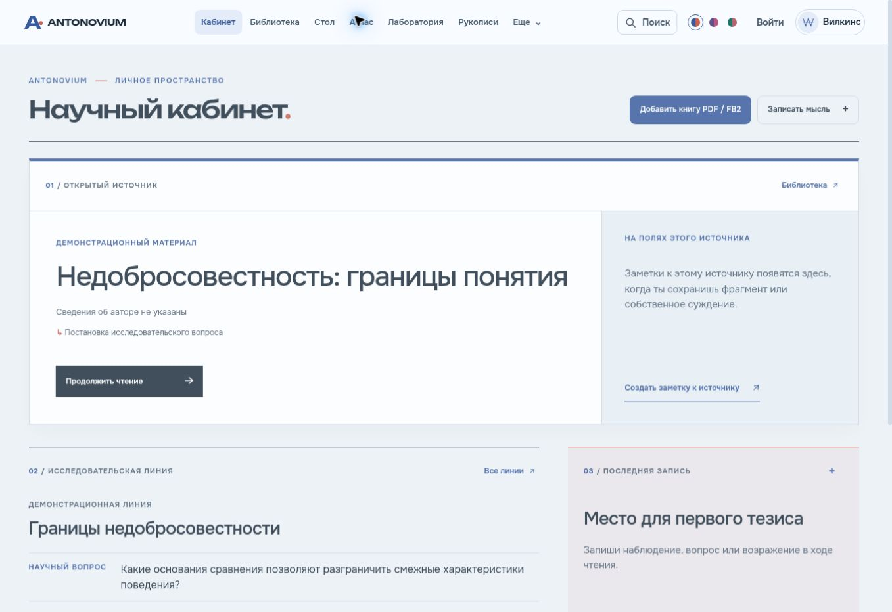
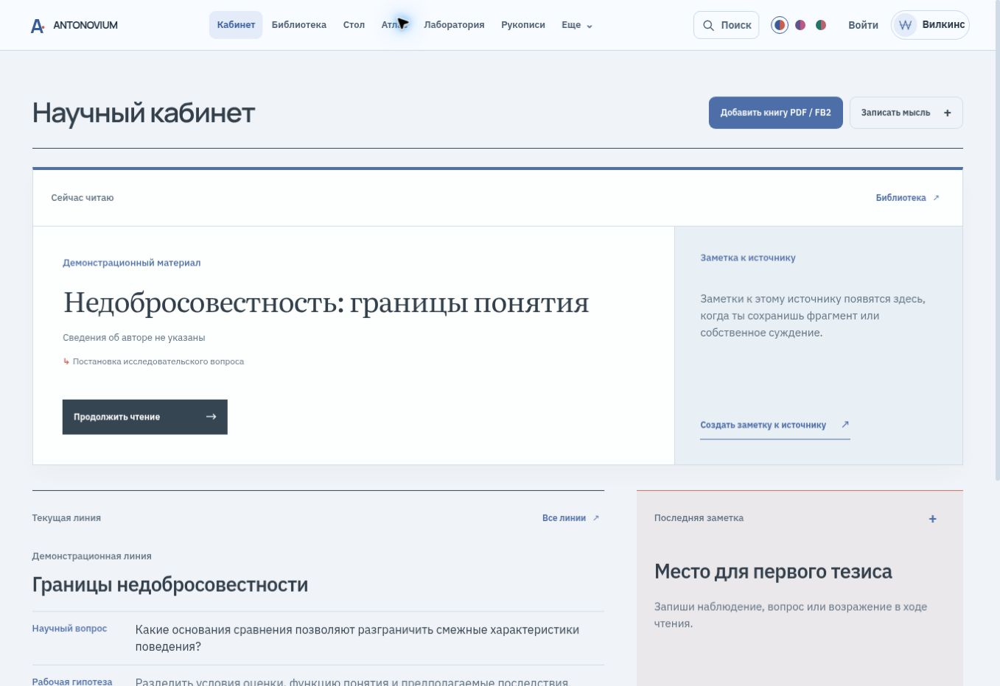

# Reader gestures and typography — 24 October 2026

Base: `05ab05f754a0e31491f7a304d172e3dc5e227ec6`.
Implementation: `0c27e5aa5a1cf90aa12943f4f381da82b0867c4f`.
Backup branch: `backup/before-mobile-reader-20261023`.

The mobile edge buttons previously rejected pointer events. The only touch-end handler recognized a PDF swipe, leaving ordinary FB2 taps without a page action. The fix gives each contact sequence one owner: Pointer Events on supported browsers, a mutually exclusive touch fallback otherwise. Duration, maximum excursion, selection, interactive targets, multiple contacts, cancellation and PDF zoom gate navigation. A recognized gesture consumes its compatibility click. Keyboard and explicit page buttons remain available.

FB2 uses one CSS column per viewport, a stride derived from actual column geometry, and programmatic horizontal movement. Text offsets remain the restoration authority across font changes, image reflow and orientation changes. Restoration callbacks carry an epoch so obsolete work cannot undo navigation. Queued contacts drain when the new chapter geometry is ready, without requiring an animation frame for every queued turn. Progress is updated after the actual position settles.

IBM Plex Sans now handles interface text, Manrope page headings, and Literata book titles and continuous reading. Onest, Manrope, IBM Plex Sans and Inter were compared on identical Russian text. Repeated section serials, uppercase labels, redundant kickers and heading periods were removed. Original CSS rules and components were edited; no extra override stylesheet was added. PDF artwork and text typography are unchanged.

Validation:

- 101 Chromium browser checks passed at widths 360, 390, 430, 768 and 1280 pixels. Each format at each width passed 20 single forward taps, 20 backward taps and 20 rapid taps, as well as excluded gestures, selection, notes, bookmarks, page boundaries and scrolling. FB2 additionally passed chapter, footnote and text-anchor restoration checks. PDF passed zoom protection and reopen checks.
- These browser contacts were synthetic PointerEvent/TouchEvent sequences with compatibility clicks, running against real browser layout. They are not a physical touchscreen test.
- An additional sequence of 20 actual browser mouse clicks at width 390 produced pages 2 through 21, without a skipped or doubled transition. The FB2 font selector was also manually switched to IBM Plex Sans and its computed font family verified.
- All eight requested workspaces passed layout checks at phone and desktop widths.
- TypeScript and production build passed. A second clean build matched all 9 active published files byte for byte.
- Regression checks passed: 19 workspace checks, 15 gesture assertions, 10 parser/migration checks, 4 PDF checks, and 9 synchronization scenarios using a simulated transport.
- Physical iOS Safari and a WebKit environment were unavailable. Native pinch, Safari selection handles and device-specific rendering remain unverified.

Supabase, authentication, Yandex storage, synchronization transport and user materials were not modified. The browser fixtures are explicitly synthetic test documents. Existing hashed production assets remain available for previously opened tabs.

Reproduce the browser checks with the Vite dev server at `/tests/reader-browser.html`, then choose **Все размеры**. Machine-readable results: [browser-validation-20261024.json](browser-validation-20261024.json).

Same desktop viewport and the same Russian cabinet content, before and after:

